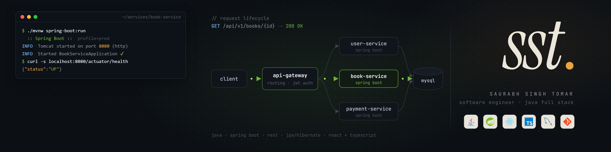
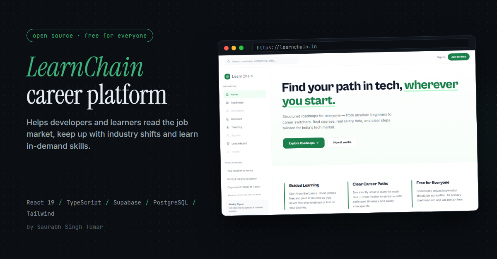
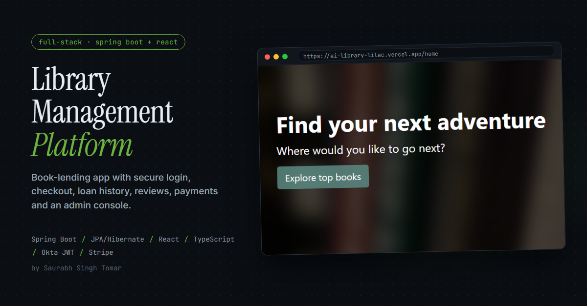

<p align="center">
  
</p>

<p align="center">
  <a href="https://www.linkedin.com/in/saurabh-tomar-dev"></a>
  <a href="https://learnchain.in"></a>
  
</p>

## About me

I'm a **Software Engineer at Capgemini** with 2+ years of experience building and supporting **Java microservices** in production for a large telecom client: developing Spring Boot services and REST APIs, taking them through release, and keeping them stable once real traffic hits them.

Production support has shaped how I build. I write code that's easy to debug, and I think about failure modes before they reach users. Outside work I build full-stack products end to end.

```yaml
backend:   [Java, Spring Boot, Spring Security, Microservices, REST APIs, Hibernate/JPA]
frontend:  [React, TypeScript, JavaScript, Tailwind CSS]
data:      [SQL, MySQL, PostgreSQL, Supabase]
practices: [Production support, Root-cause analysis, Agile/Scrum, Git]
```

## Featured projects

<table>
  <tr>
    <td width="50%" valign="top">
      <a href="https://learnchain.in"></a>
      <h3><a href="https://github.com/SaurabhTomar123/learnChain-v2">LearnChain</a> · open source</h3>
      A free, open-source career platform that helps developers and learners understand the job market, keep up with how the industry is changing, and learn the skills it now demands.
      <br><br>
      Roadmaps (fresher → senior) with real ₹ LPA salary data · a weekly <b>Learning OS</b> planner with email reminders · squads with real-time chat · XP and leaderboards.
      <br><br>
      <code>React 19</code> <code>TypeScript</code> <code>Supabase</code> <code>PostgreSQL</code> <code>Tailwind</code>
      <br><br>
      <a href="https://learnchain.in">Live site</a> · <a href="https://github.com/SaurabhTomar123/learnChain-v2">Code</a>
    </td>
    <td width="50%" valign="top">
      <a href="https://ai-library-lilac.vercel.app/home"></a>
      <h3><a href="https://github.com/SaurabhTomar123/AI-Library">Library Management Platform</a></h3>
      A full-stack book-lending app: Spring Boot REST APIs with Spring Data REST and JPA/Hibernate, and a React + TypeScript frontend.
      <br><br>
      Search, checkout and loan history · reviews · Okta OAuth2/JWT login with an admin role · Stripe payments for late fees.
      <br><br>
      <code>Spring Boot</code> <code>JPA</code> <code>React</code> <code>TypeScript</code> <code>Okta</code> <code>Stripe</code>
      <br><br>
      <a href="https://ai-library-lilac.vercel.app/home">Live app</a> · <a href="https://github.com/SaurabhTomar123/AI-Library">Code</a>
    </td>
  </tr>
</table>

**Currently building:** [ShiftPilot](https://github.com/SaurabhTomar123/ShiftPilot), being rebuilt as a workforce scheduling and roster-repair product. The previous version was an AI operations agent with an MCP tool server, human approval for every change, and an eval suite that gates CI.

## GitHub activity

<p align="center">
  
  
</p>
